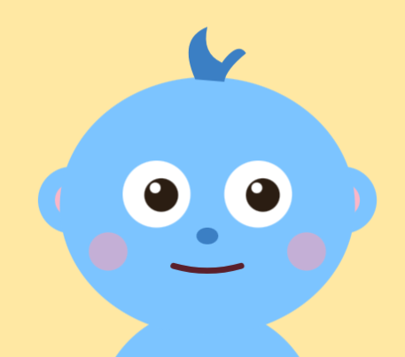
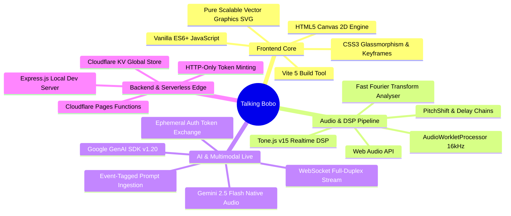
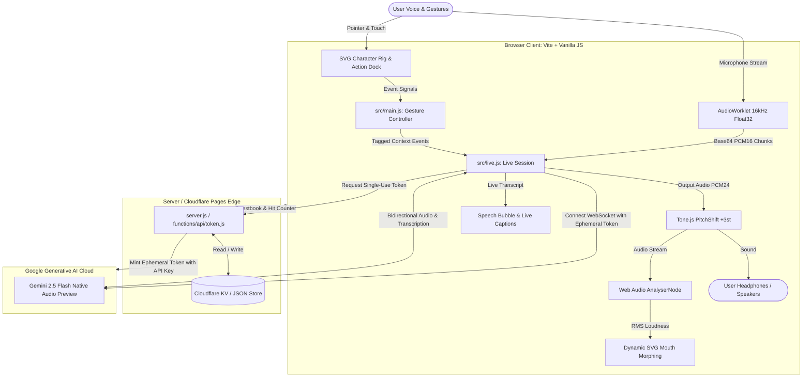
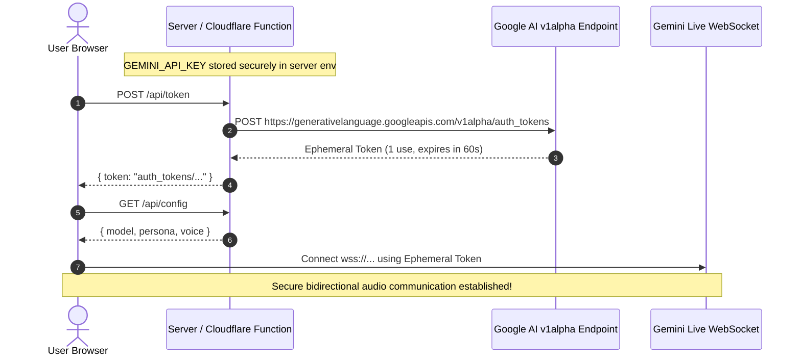

<div align="center">



# ✨ Bobo: The Celestial Dream Weaver & AI Companion

**An original, interactive 2D celestial baby pet powered by the Gemini 2.5 Flash Multimodal Live API.**
*Real-time bidirectional speech, dynamic SVG procedural animations, DSP pitch-shifting, and a full celestial portfolio experience.*

[](https://ai.google.dev/)
[](https://tonejs.github.io/)
[](https://pages.cloudflare.com/)
[](LICENSE)

[Features](#-key-features) • [Architecture](#-system-architecture) • [Audio Pipeline](#-gemini-live-audio-pipeline) • [Interaction Matrix](#-touch--action-interaction-matrix) • [Codebase & Functions](#-codebase-function-breakdown) • [Getting Started](#-getting-started) • [Deployment](#-deployment)

---

</div>

## 🌌 Overview

**Bobo** is an adorably sweet, celestial creature living right on your screen. Unlike traditional "echo pets" that simply repeat back recorded audio, Bobo engages in **true, spontaneous, bidirectional voice conversations** with ultra-low latency through the Google Gemini Multimodal Live API.

Equipped with physical touch gesture detection, procedurally animated SVG facial features, real-time audio pitch transformation, and context-aware reactions, Bobo knows when you pet his head, boop his nose, feed him a donut, or leave him alone.

Beyond the talking pet, Bobo comes packaged in a full **interactive celestial portfolio** featuring an interactive bedtime storybook with AI story weaving, a synthesized lullaby music box, a canvas-based falling star arcade game, and an edge-persisted guestbook.

---

## 🚀 Key Features

- 🎙️ **Real-Time Bidirectional Voice**: Powered by Google's native audio Live API (`gemini-2.5-flash-native-audio-preview-09-2025`) using full-duplex WebSockets.
- ⚡ **Zero Client-Exposed Keys**: Ephemeral single-use auth tokens generated via backend edge functions ensure your API key remains 100% secure.
- 🧒 **Cartoon Voice Pitch Shifting**: Real-time DSP pitch shifting via `Tone.PitchShift` transforms standard voices (`Puck`) into a wholesome, whimsical baby creature tone.
- 👄 **Hardware-Accelerated Lip Sync**: Real-time Web Audio `AnalyserNode` calculates output RMS amplitude on every animation frame to procedurally morph Bobo's SVG mouth.
- 🖐️ **Multi-Zone Physical Touch**: Vector hit-testing for petting (drag gesture), poking, cheek-stretching, ear-tugging, foot-tickling, and nose-booping.
- 🍩 **Flanking Action Dock**: Interactive props for feeding strawberry donuts, sipping boba milk, bashful sneezing, dancing, sleeping, spinning dizzy, and rocking sunglasses.
- 📜 **Bedtime Story Weaver**: An interactive storybook engine with custom generative story creation across themes, celestial companions, and soothing lessons.
- 🎹 **Lullaby Lab Synthesizer**: In-browser musical keyboard and procedural generative lullaby synthesizer with live frequency visualization.
- 🎮 **Dream Catcher Mini-Game**: HTML5 Canvas arcade game catching stars and clouds with particle burst effects, combos, and high scores.
- 📖 **Edge-Persisted Guestbook & Hits Counter**: Real-time visitor log and rolling odometer counter backed by Cloudflare Pages Functions & KV.
- 🌓 **Day / Night Celestial Theme**: Fluid transitions between twilight day and deep night sky with glowing golden star trails.

---

## 🛠️ Tech Stack



| Domain | Technology / Library | Purpose |
| :--- | :--- | :--- |
| **Language & Runtime** | JavaScript (ES Modules) / Node.js 18+ | Universal client & server logic |
| **Frontend Framework** | Vanilla HTML5 / CSS3 / ES6+ | Lightweight, ultra-fast 60 FPS animation performance |
| **Styling & Theme** | Vanilla CSS + CSS Variables | Celestial dark/light gradients, glassmorphism, responsive dock |
| **Vector Animation** | Pure SVG + CSS Transforms | Infinitely scalable, lightweight character rig with zero raster lag |
| **Audio Synthesis & DSP**| Web Audio API + Tone.js 15.1 | Procedural SFX, lullaby music box, and live vocal pitch alteration |
| **Voice Streaming** | Google GenAI SDK (`@google/genai`) | Low-latency full-duplex WebSocket connection to Gemini Live |
| **Client Bundler** | Vite 5.4 | Fast HMR dev server & tree-shaken static production bundle |
| **Server / Edge APIs** | Express 4 (Local) / Cloudflare Functions (Prod)| Token exchange, guestbook persistence, and hit counter |
| **Persistence** | Cloudflare KV / Local JSON | Distributed edge key-value storage for guestbook and visitor stats |

---

## 🏗️ System Architecture

### 1. High-Level System Overview



---

### 2. Security & Ephemeral Token Exchange

To prevent exposing `GEMINI_API_KEY` to browser clients, Talking Bobo utilizes an **ephemeral authorization token exchange**:



---

## 🔊 Gemini Live Audio Pipeline

```mermaid
flowchart LR
    subgraph Microphone Capture
        Mic[User Mic] -->|MediaStream| CtxIn[AudioContext 16kHz]
        CtxIn --> AudioWorklet[Custom AudioWorklet 'p']
        AudioWorklet -->|100ms Float32 Chunks| Int16[Float-to-Int16 PCM Buffer]
        Int16 --> Base64[Base64 Encoding]
        Base64 -->|sendRealtimeInput| WSSend[WebSocket Upstream]
    end

    subgraph Gemini Cloud
        WSSend --> Model((Gemini 2.5 Flash Live))
        Model --> WSReceive[WebSocket Downstream]
    end

    subgraph Playback & Visualizer
        WSReceive -->|Base64 PCM24 Audio| Decoder[Linear 24kHz Decoder]
        Decoder --> AudioBuf[AudioBufferSourceNode]
        AudioBuf --> ToneShift[Tone.PitchShift +3 Semitones]
        ToneShift --> Analyser[Web Audio AnalyserNode FFT=256]
        Analyser --> Speakers[Destination: Headphones]
        Analyser -->|getByteTimeDomainData| LipSync[Procedural Mouth Height]
    end
```



### Technical Audio Specifications:
- **Input Format**: 16,000 Hz, 1-channel mono PCM16, transmitted in 100 ms slices (1,600 samples) via a dedicated `AudioWorkletProcessor`.
- **Output Format**: 24,000 Hz raw signed 16-bit PCM streamed directly from the Gemini Live session.
- **Vocal Transformation**: Processed in real time through `Tone.PitchShift` (configured with `windowSize: 0.06`, `feedback: 0`, `wet: 1.0`, pitch altered by `+3` semitones) creating Bobo's sweet baby creature cadence.
- **Barge-In / Interruption**: When Gemini detects user speech mid-response, an `interrupted: true` flag is received; Bobo instantly halts current audio buffer sources, flushes buffers, and resets captions.
- **Speech Captions**: Real-time subtitles populated dynamically via `outputAudioTranscription`.

---

## 🎮 Touch & Action Interaction Matrix

Bobo reacts both physically (with vector animations and synthesised audio) and conversationally (dispatching invisible contextual prompt events to Gemini Live).

### 1. Direct Physical Touches (Pointer / Touch Event Zones)

| Gesture | Target Zone | Animation Class | Offline Sound | Live Context Event Dispatched |
| :--- | :--- | :--- | :--- | :--- |
| **Tap Head** | `[data-zone="head"]` | `.happy` | Gentle purr | `[event] user gently bumped your head...` |
| **Drag Head** | `[data-zone="head"]` (>220px) | `.happy` | Sustained purr | `[event] user is gently petting your head...` |
| **Boop Nose** | `[data-zone="nose"]` | `.squish` | High boop tone | `[event] user booped your nose...` |
| **Tug Ears** | `[data-zone="*ear"]` | `.squish` | Playful squeak | `[event] user gently touched your soft ear...` |
| **Squish Cheeks** | `[data-zone="*cheek"]` | `.squish` | Soft squeak | `[event] user gently squished your chubby cheeks...` |
| **Tickle Feet** | `[data-zone="*foot"]` | `.laugh` | High giggle | `[event] user tickled your tiny feet...` |
| **Tap Belly** | `[data-zone="belly"]` | `.squish` | Squeak | `[event] user poked your belly softly...` |
| **4x Fast Belly Taps** | `[data-zone="belly"]` (<=1.5s) | `.laugh` | Giggle burst | `[event] user is tickling your belly...` |
| **Eye Tracking** | Whole stage (`pointermove`)| Pupil offset | Dynamic | Pupils follow cursor across coordinates |
| **Idle (25s–45s)** | None | `.bored` | Squeak | `[event] user has been quiet for a while...` |

### 2. Flanking Action Dock

| Action | Control Button | Visual Animation | SFX Synthesis | Live Voice Response |
| :--- | :--- | :--- | :--- | :--- |
| **Feed Snack** | `feed` | Donut floats in, crumbs burst, rhythmic chewing | Munching chomp sequence | *"Mmm, yummy! Thank you!"* |
| **Drink Milk** | `drink` | Boba cup slides up, liquid drains, straw sipping | Slurping dual-tone frequency | *"Slurp! So refreshing, thanks!"* |
| **Bashful Sneeze** | `fart` | Bobo shivers, blushes deeply, sneezes bashfully | Squeak / gentle pop | *"Oopsie! Excuse me! \*blushes\*"* |
| **Dance Party** | `dance` | Groovy lateral bouncing, blinking stars | Melodic square-wave bounce | *"Yay! Let's dance happily!"* |
| **Nap Bedtime** | `sleep` | Eyelids close, rising `Zzz` bubbles drift upward | Soft downward sine yawn | *"Sweet dreams, sleep tight..."* |
| **Dizzy Spin** | `dizzy` | Eyes turn to spirals, stage wobbles 360° | Alternating wobble frequency | *"Wheee! So many stars!"* |
| **Cool Mode** | `cool` | Golden sunglasses slide onto Bobo, sparkle flash | Sparkle chord chime | *"Look, we're shining bright!"* |

---

## 📂 Codebase & Function Breakdown

```
talking-bobo/
├── index.html                   # Master SVG character rig, styles & tab templates
├── server.js                    # Local Express server: token minting & JSON API
├── package.json                 # Project dependencies & concurrently scripts
├── vite.config.js               # Vite bundler configuration
├── wrangler.toml                # Cloudflare Pages deployment configuration
├── public/                      # Static assets & edge routing headers
│   ├── logo.png                 # Official Bobo celestial icon
│   ├── _headers                 # CORS and security response headers
│   ├── _routes.json             # Cloudflare Pages Functions routing rules
│   └── site.webmanifest         # PWA progressive web app manifest
├── functions/api/               # Cloudflare Pages Serverless Edge Functions
│   ├── token.js                 # POST /api/token: Google GenAI auth_tokens minting
│   ├── config.js                # GET /api/config: Model, voice & system instructions
│   ├── guestbook.js             # GET/POST /api/guestbook: KV guestbook storage
│   ├── hit.js                   # POST /api/hit: Visitor increment counter
│   └── hits.js                  # GET /api/hits: Read visitor count
└── src/                         # Client-side source modules
    ├── live.js                  # Gemini Live WebSockets & Audio DSP Manager
    ├── main.js                  # Character controller, gestures & dock interactions
    ├── sfx.js                   # Web Audio API synthesizers & music box
    ├── portfolio.js             # Multi-tab logic, storybook, lullaby lab, arcade
    ├── sparkles.js              # HTML5 particle canvas trail system
    └── portfolio.css            # Design tokens, layouts & responsive stylesheets
```

### Module Breakdown & Core Functions

#### 1. [`src/live.js`](file:///c:/Users/HP/Downloads/talking-bobo/talking-bobo/src/live.js) — *Gemini Live & DSP Audio Manager*
- `class Live`: Orchestrates client-side audio capture, bidirectional WebSocket streaming, pitch shifting, and barge-in management.
  - `connect()`: Initializes AudioContext, fetches ephemeral token from `/api/token`, opens `ai.live.connect` WebSocket stream, configures `Tone.PitchShift`, and connects `AnalyserNode`.
  - `startMic()`: Requests microphone stream with echo cancellation; attaches custom `AudioWorkletProcessor` downsampling audio to 16 kHz PCM and streaming chunks upstream via `sendRealtimeInput()`.
  - `onMsg(message)`: Handles downstream server events:
    - Detects `interrupted` to immediately invoke `flush()` and clear captions.
    - Extracts live text from `outputAudioTranscription` or `modelTurn.parts`.
    - Routes incoming PCM24 base64 chunks to `play()`.
  - `play(base64)`: Decodes 24 kHz audio buffer, schedules gapless playback on `Tone.PitchShift`, and manages active source tracking for cancellation.
  - `flush()`: Aborts and disconnects all currently queued audio buffers.
  - `meter()`: Runs a `requestAnimationFrame` loop querying `analyser.getByteTimeDomainData` to calculate instantaneous loudness passed to `onLevel()`.
  - `sendText(text)`: Dispatches tagged context messages (e.g. `[event] ...`) through the live WebSocket.
  - `setMute(val)`: Enables or disables audio input tracks without terminating the active connection.
  - `stop()`: Gracefully tears down mic tracks, AudioContexts, pitch shifters, and the WebSocket session.

#### 2. [`src/main.js`](file:///c:/Users/HP/Downloads/talking-bobo/talking-bobo/src/main.js) — *Character Rig & Interaction Controller*
- `showSpeech(text, append, duration)`: Updates speech bubble above Bobo and the live subtitle banner with auto-hide timers.
- `setMouth(openRatio)`: Morphologically interpolates the SVG mouth path (`#mouth`) from closed to open.
- `flap(ms)` / `chewMouth(times)` / `sipMouth(times)`: Procedural fallback mouth animation loops for offline actions.
- `fx(cls, ms)`: Applies keyframed CSS animation classes to the master SVG rig.
- `setCallState(state)`: Updates UI state pills and microphone controls (`idle`, `connecting`, `active`).
- `react({ say, text, cls, sound, ms, force })`: Central dispatcher handling animation triggers, SFX playback, caption display, and conditional Gemini Live context event delivery.
- `R`: Hashmap of touch responses (`hit`, `pet`, `belly`, `tickle`, `nose`, `ear`, `cheek`, `foot`) and dock actions (`feed`, `drink`, `fart`, `dance`, `sleep`, `dizzy`, `cool`).
- `Pointer Event Listeners`: Captures drag distance on `#head` to distinguish between petting and tapping; tracks coordinate offsets to point pupils (`#pupils`) toward the cursor.
- `resetIdle()` / `idle()`: Initiates random taunts and affectionate prompts when user has been idle for 25–45 seconds.

#### 3. [`src/sfx.js`](file:///c:/Users/HP/Downloads/talking-bobo/talking-bobo/src/sfx.js) — *Zero-Asset Procedural Audio Synthesizer*
- `tone(f0, f1, duration, type, volume)`: Synthesizes dynamic pitch-ramped audio notes using Web Audio `OscillatorNode` and `GainNode`.
- `seq(count, interval, fn)`: Helper executing rhythmic timed note sequences.
- `sfx`: Suite of generated effects:
  - UI sounds: `click()`, `pop()`, `tab()`, `success()`, `crack()`.
  - Creature sounds: `ouch()`, `squeak()`, `boop()`, `purr()`, `giggle()`, `chomp()`, `slurp()`, `fart()`, `yawn()`, `dizzy()`, `dance()`, `bling()`.
- `playLullabyNote(freq, duration)`: Generates warm, bell-like music box timbre with exponential decay envelopes.
- `stopLullaby()`: Halts running melody sequences.

#### 4. [`src/portfolio.js`](file:///c:/Users/HP/Downloads/talking-bobo/talking-bobo/src/portfolio.js) — *Celestial Portfolio Application*
- `switchTab(tabId)`: Handles client-side view swapping across `home`, `about`, `projects`, `story`, `lab`, `play`, and `guest`.
- `initHitCounter()` / `animateOdometer(count)`: Queries `/api/hit` and rolls mechanical odometer digits.
- `buildStorybook()` / `goToPage(idx)` / `narrateCurrentPage()`: Multi-page illustrated interactive storybook with web speech narration.
- `generateBedtimeStory()`: Procedural bedtime story engine combining chosen protagonists, realms, and moral lessons.
- `initLabViz()` / `playLullaby()`: Canvas frequency visualizer paired with generative lullaby playback.
- `initGameCanvas()` / `startGame()` / `spawnItem()` / `endGame()`: Full 60 FPS HTML5 Canvas arcade game where users control a celestial basket catching falling stars and moonbeams.
- `loadGuestbook()`: Asynchronously fetches and renders visitor messages with sanitized HTML.

#### 5. [`server.js`](file:///c:/Users/HP/Downloads/talking-bobo/talking-bobo/server.js) & [`functions/api/*`](file:///c:/Users/HP/Downloads/talking-bobo/talking-bobo/functions/api/) — *Secure Edge Endpoints*
- `POST /api/token`: Calls Google GenAI `authTokens.create` to mint 1-use tokens with a 60-second connection window.
- `GET /api/config`: Returns runtime configuration (`LIVE_MODEL`, `persona`, `voice`).
- `GET/POST /api/guestbook`: Reads and writes visitor log entries (supports Cloudflare KV with graceful in-memory/JSON fallbacks).
- `GET/POST /api/hits` & `/api/hit`: Atomic visitor odometer increment and read operations.

---

## ⚡ Getting Started

### Prerequisites

- [Node.js](https://nodejs.org/) v18.0.0 or higher
- A Google Gemini API Key from [Google AI Studio](https://aistudio.google.com/)

### 1. Clone & Install

```bash
git clone https://github.com/your-username/talking-bobo.git
cd talking-bobo
npm install
```

### 2. Configure Environment

Create a `.env` file in the project root:

```bash
cp .env.example .env
```

Add your Gemini API Key:

```env
GEMINI_API_KEY=AIzaSy...your_actual_key_here
LIVE_MODEL=gemini-2.5-flash-native-audio-preview-09-2025
VOICE=Puck
```

### 3. Run Locally

Start both the backend token server (`:8787`) and the Vite development server (`:5173`) concurrently:

```bash
npm run dev
```

Open your browser at:
```
http://localhost:5173
```

> [!TIP]
> **Use Headphones**: Because Bobo speaks and listens simultaneously through the full-duplex Live API, wearing headphones prevents your microphone from feeding Bobo's voice back into himself!

---

## ☁️ Deployment

Talking Bobo is architected for zero-configuration, instant deployment on **Cloudflare Pages** with serverless edge functions.

### Option A: Cloudflare Native Git Integration (Recommended)

1. Push your repository to GitHub.
2. In the [Cloudflare Dashboard](https://dash.cloudflare.com/), navigate to **Workers & Pages** > **Create application** > **Pages** > **Connect to Git**.
3. Select your repository and apply the following build settings:
   - **Framework preset**: `Vite`
   - **Build command**: `npm run build`
   - **Build output directory**: `dist`
4. Expand **Environment variables** and add:
   - `GEMINI_API_KEY`: Your Google Gemini API Key.
5. Click **Save and Deploy**.

### Option B: Cloudflare KV for Global Guestbook Persistence

To persist guestbook messages and visitor counts permanently across all Cloudflare edge regions:
1. In Cloudflare dashboard, go to **Workers & Pages** > **KV** > **Create a namespace** named `bobo-data`.
2. Go to your Pages project > **Settings** > **Functions** > **KV namespace bindings**.
3. Click **Add binding**:
   - Variable name: `BOBO_KV`
   - KV namespace: `bobo-data`
4. Redeploy. The edge APIs will automatically detect and bind to `BOBO_KV`!

For GitHub Actions CI/CD instructions, see [`CLOUDFLARE_DEPLOY.md`](file:///c:/Users/HP/Downloads/talking-bobo/talking-bobo/CLOUDFLARE_DEPLOY.md).

---

## 🎨 Design Philosophy & Theme

Bobo's design follows a **cozy celestial aesthetic**:
- **Palette**: Deep midnight blues (`#0a0f1d`), twilight indigos (`#1e1b4b`), soft starlight creams (`#fef3c7`), celestial baby cyan (`#7cc4ff`), and radiant gold accents (`#fbbf24`).
- **Typography**: Clean, rounded modern sans-serif typography with generous line-heights and legible hierarchy.
- **Zero Heavy Assets**: Pure SVG character rigging and procedural Web Audio means lightning-fast initial page loads (<1s) with zero external audio or sprite sheet dependencies.
- **Micro-Animations**: Bouncing stars, breathing idle animations, dynamic eye-tracking, and golden cursor sparkle trails create a responsive, living world.

---

## 🤝 Contributing

Contributions, feature suggestions, and bug reports are warmly welcomed!
1. Fork the Project
2. Create your Feature Branch (`git checkout -b feature/AmazingFeature`)
3. Commit your Changes (`git commit -m 'Add some AmazingFeature'`)
4. Push to the Branch (`git push origin feature/AmazingFeature`)
5. Open a Pull Request

---

## 📄 License

Distributed under the MIT License. See `LICENSE` for more information.

<div align="center">

Made with 🩵, stardust, and the Google Gemini Live API.

[Back to top ↑](#-bobo-the-celestial-dream-weaver--ai-companion)

</div>
